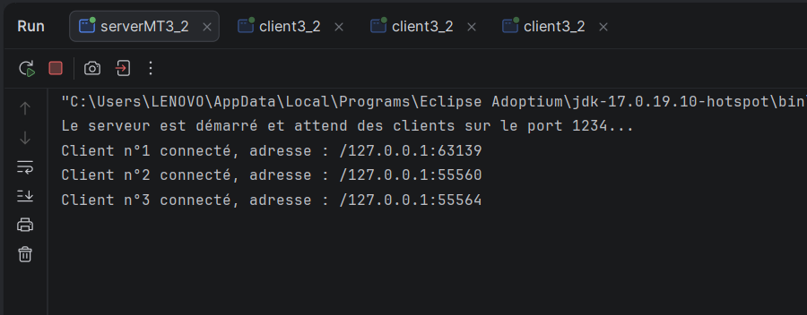
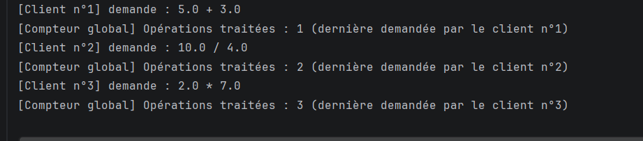
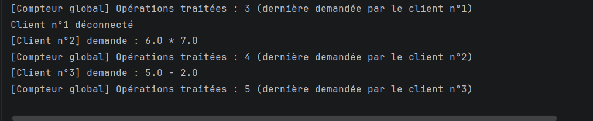
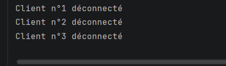
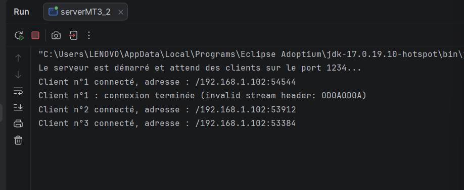

# TP 3 - Activité 3-1 : Acceptation de plusieurs clients


## 1. Objectif

Concevoir un serveur **multi-thread** basé sur les sockets TCP en Java, capable de gérer **plusieurs clients simultanément**. Pour chaque client connecté, le serveur :

- affiche son adresse IP et son numéro d'ordre de connexion (client n°1, n°2, etc.) ;
- lui envoie son numéro d'ordre ;
- lui dédie un thread indépendant.


| Classe | Rôle |
|---|---|
| `serverMT` | Écoute sur le port **1234**. Dans une boucle infinie, appelle `accept()`, incrémente le numéro d'ordre, affiche l'adresse du client (`getRemoteSocketAddress()`), puis démarre un `ClientProcess`. |
| `ClientProcess` | Thread qui envoie le message de bienvenue contenant le numéro du client, puis lit chaque ligne reçue, l'affiche côté serveur et renvoie un écho. Ferme sa propre socket à la fin. |
| `client` | Se connecte avec `InetAddress` et `InetSocketAddress` (timeout de 5 s), affiche le message de bienvenue, puis envoie des messages jusqu'à la saisie de `quit`. |


## 2. Exécution

1. Lancer `serverMT` (message attendu : `Le serveur attend la connexion d'un client...`).
2. Lancer un ou plusieurs clients : Telnet (`telnet localhost 1234`) ou `clientMT`.
3. Pour le test en réseau local : remplacer `IP_SERVEUR = "localhost"` par l'adresse IPv4 de la machine serveur dans `clientMT`.

---

## 3. Tests et captures d'écran


### Test 1 : Connexion de deux clients Telnet


**Synthèse :** Deux fenêtres Telnet se connectent avec `telnet localhost 1234`. Chacune reçoit son numéro d'ordre (client n°1 et client n°2). La console du serveur affiche l'adresse IP et le port de chaque client ainsi que les messages reçus. Cela montre que le serveur gère plusieurs clients en même temps, chacun dans son propre thread.

### Test 2 : Connexion de clients Java


**Synthèse :** Plusieurs instances de `client` sont lancées. Chaque client reçoit un numéro d'ordre unique qui continue la numérotation du serveur. Les messages envoyés alternativement par les clients reçoivent chacun leur écho sans interférence, ce qui confirme l'indépendance des communications.

### Test 3 : Déconnexion d'un client


**Synthèse :** Après la saisie de `quit` dans un client, le serveur affiche `Client n°X déconnecté`. Les autres clients restent connectés et continuent à échanger avec le serveur, car chaque thread ferme uniquement sa propre socket.

### Test 4 : Test en réseau local 


**Synthèse :**  le test en réseau local a été réalisé avec le PC serveur et un téléphone connecté au même réseau Wi-Fi. Dans `clientMT`, la constante `IP_SERVEUR` a été remplacée par l'adresse IPv4 du PC serveur (`192.168.1.208`) au lieu de `localhost`, afin que la connexion passe par l'interface réseau. Parallèlement, des connexions ont été ouvertes depuis le téléphone avec une application Telnet (`Termux`) vers la même adresse et le même port (1234). Le serveur a accepté toutes ces connexions simultanément et a affiché pour chacune l'adresse IP du client (`192.168.1.20` pour les connexions reçues depuis le téléphone), un port différent et son numéro d'ordre (client n°1, n°2, n°3). Cela prouve que la communication passe bien par le réseau local et que le serveur gère plusieurs clients en parallèle, y compris depuis un appareil distinct. Le port 1234 a dû être autorisé dans le pare-feu du PC serveur.


# Activité 3-2 : Amélioration de l'application calculatrice


| Classe | Rôle |
|---|---|
| `Operation` | Classe `Serializable` contenant `operande1`, `operateur`, `operande2`, `resultat` et `erreur`. Le client la remplit, le serveur la complète et la renvoie. |
| `serverMT3_2` | Écoute sur le port **1234**, numérote les clients, affiche leur adresse IP et lance un `ClientProcess3_2` par client. |
| `ClientProcess3_2` | Reçoit les objets `Operation`, calcule (`+`, `-`, `*`, `/`), incrémente le compteur global et renvoie l'objet complété. |
| `client3_2` | Se connecte avec `InetAddress` et `InetSocketAddress`, saisit les opérations, envoie un objet `Operation` et affiche le résultat. `quit` ferme la connexion. |

## 1. Choix techniques

### 1.1 Communication par objets

Les flux `BufferedReader` / `PrintWriter` de l'activité 3-1 sont remplacés par `ObjectOutputStream` / `ObjectInputStream`. Le serveur et le client créent d'abord le flux de sortie (avec `flush()`), puis le flux d'entrée : si les deux côtés créaient d'abord l'entrée, ils s'attendraient mutuellement et se bloqueraient. La classe `Operation` est placée dans un package commun, car le client et le serveur doivent en avoir la même version pour la désérialisation.

### 1.2 Gestion de l'accès concurrent

```java
private static int compteurGlobal = 0;

private static synchronized int incrementerCompteur(int numeroClient) {
    compteurGlobal++;
    System.out.println("[Compteur global] Opérations traitées : " + compteurGlobal );
    return compteurGlobal;
}
```

- `static` : une seule copie du compteur, partagée par tous les threads `ClientProcess3_2`.
- `synchronized` : un seul thread à la fois exécute la méthode. Sans cela, deux threads pourraient lire la même valeur et perdre une incrémentation.
- L'affichage est dans la même méthode synchronisée : les valeurs apparaissent dans l'ordre, sans doublon.

### 1.3 Gestion des erreurs

La division par zéro et un opérateur invalide sont signalés par le champ `erreur` de l'objet renvoyé. Le client vérifie aussi les nombres et l'opérateur saisis avant l'envoi.


## 2. Exécution

1. Lancer `serverMT3_2` (message : `Le serveur est démarré et attend des clients sur le port 1234...`).
2. Lancer plusieurs instances de `client3_2` (option *Allow multiple instances* dans IntelliJ).
3. Saisir pour chaque opération : opérande 1, opérateur, opérande 2. Taper `quit` pour arrêter un client.
4. Pour un test depuis une autre machine : remplacer `IP_SERVEUR = "localhost"` par l'adresse IPv4 du PC serveur dans `client3_2`.

---

## 3. Tests 

### Test 1 : Connexion de plusieurs clients



**Synthèse :** Trois instances de `client3_2` sont lancées. Chacune reçoit son numéro d'ordre (client n°1, n°2, n°3) sous forme d'objet `String`, et le serveur affiche l'adresse IP de chaque client. Chaque client est traité par un thread dédié.

### Test 2 : Opérations en parallèle depuis plusieurs clients



**Synthèse :** Des opérations différentes (par exemple `5 + 3`, `10 / 4`, `2 * 7`) sont envoyées en alternant entre les clients. Chaque client reçoit le résultat de sa propre opération, sans interférence avec les autres, ce qui confirme l'indépendance des communications.

### Test 3 : Compteur global synchronisé



**Synthèse :** À chaque opération traitée, le serveur incrémente le compteur global et affiche sa nouvelle valeur (1, 2, 3, 4, ...), avec le numéro du client concerné. Les valeurs se suivent sans trou ni doublon même avec plusieurs clients en parallèle, ce qui montre que la synchronisation protège correctement la ressource partagée.


### Test 4 : Déconnexion d'un client



**Synthèse :** Après la saisie de `quit`, le serveur affiche `Client n°X déconnecté` et ferme la socket de ce client.

### Test 5 : Test en réseau local (plusieurs machines)



**Synthèse :**  Le serveur est lancé sur le PC (adresse IPv4 `192.168.1.208`) et le port 1234 est autorisé dans le pare-feu. Un client `client3_2`, dont la constante `IP_SERVEUR` a été remplacée par cette adresse, est lancé depuis `téléphone`. Le serveur affiche l'adresse de la machine distante, ce qui prouve que la communication passe par le réseau local, et les opérations sont traitées normalement avec le compteur global.


