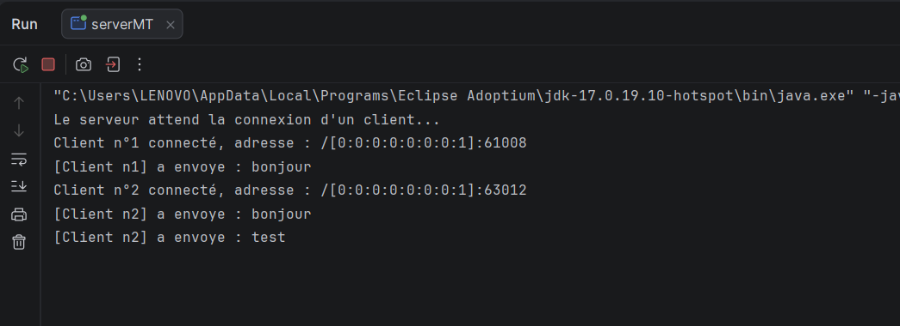
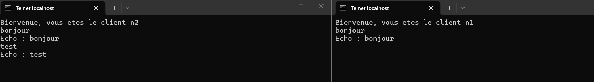
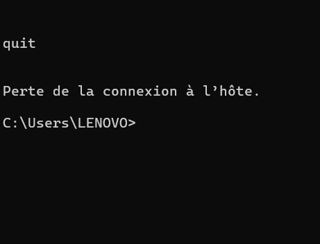
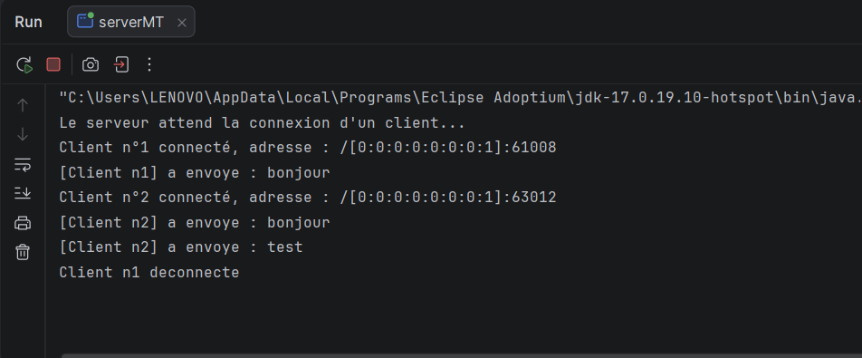
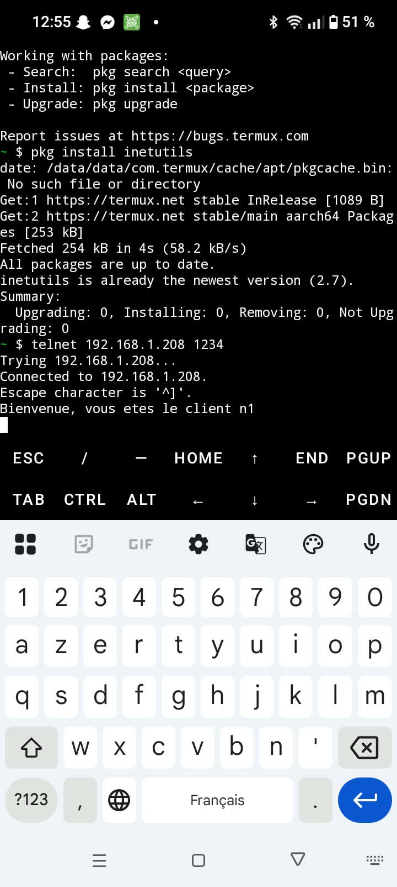
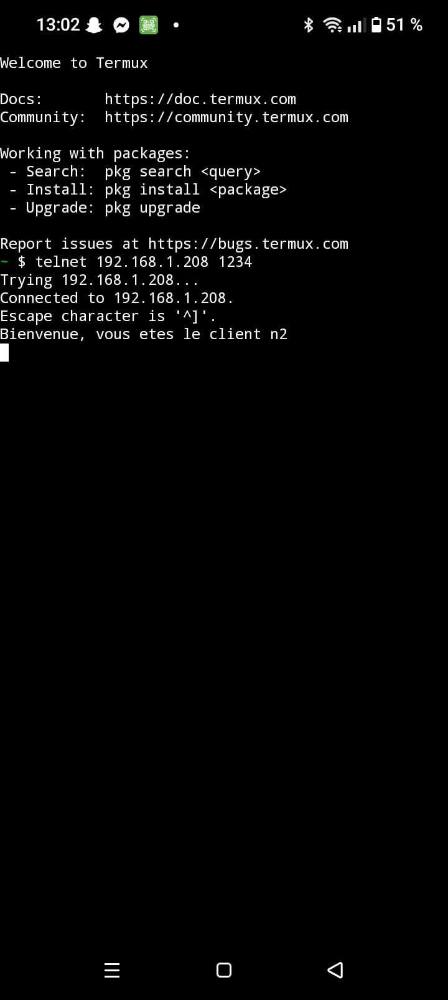
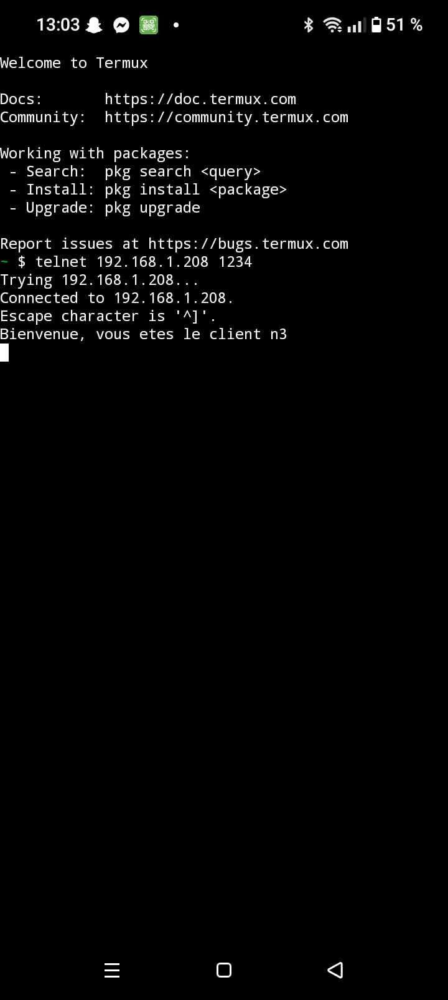
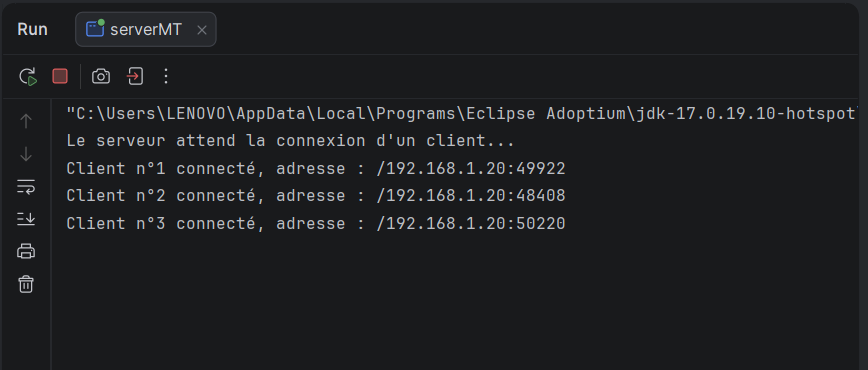

# TP 3 - Activité 3-1 : Acceptation de plusieurs clients

## 1. Objectif

Concevoir un serveur **multi-thread** basé sur les sockets TCP en Java, capable de gérer **plusieurs clients simultanément**. Pour chaque client connecté, le serveur :

- affiche son adresse IP et son numéro d'ordre de connexion (client n°1, n°2, etc.) ;
- lui envoie son numéro d'ordre ;
- lui dédie un thread indépendant.

| Classe | Rôle |
|---|---|
| `serverMT` | Écoute sur le port **1234**. Dans une boucle infinie, appelle `accept()`, incrémente le numéro d'ordre, affiche l'adresse du client (`getRemoteSocketAddress()`), puis démarre un `ClientProcess`. |
| `ClientProcess` | Thread qui envoie le message de bienvenue contenant le numéro du client, puis lit chaque ligne reçue, l'affiche côté serveur et renvoie un écho. Ferme sa propre socket à la fin. |
| `clientMT` | Se connecte avec `InetAddress` et `InetSocketAddress` (timeout de 5 s), affiche le message de bienvenue, puis envoie des messages jusqu'à la saisie de `quit`. |

## 4. Exécution

1. Lancer `serverMT` (message attendu : `Le serveur attend la connexion d'un client...`).
2. Lancer un ou plusieurs clients : Telnet (`telnet localhost 1234`) ou `clientMT`.
3. Pour le test en réseau local : remplacer `IP_SERVEUR = "localhost"` par l'adresse IPv4 de la machine serveur dans `clientMT`.

---

## 5. Tests et captures d'écran

### Test 2 : Connexion de deux clients Telnet

**Synthèse :** Deux fenêtres Telnet se connectent avec `telnet localhost 1234`. Chacune reçoit son numéro d'ordre (client n°1 et client n°2). La console du serveur affiche l'adresse IP et le port de chaque client ainsi que les messages reçus. Cela montre que le serveur gère plusieurs clients en même temps, chacun dans son propre thread.

### Test 3 : Connexion de clients Java

**Synthèse :** Plusieurs instances de `client` sont lancées. Chaque client reçoit un numéro d'ordre unique qui continue la numérotation du serveur. Les messages envoyés alternativement par les clients reçoivent chacun leur écho sans interférence, ce qui confirme l'indépendance des communications.

### Test 4 : Déconnexion d'un client

**Synthèse :** Après la saisie de `quit` dans un client, le serveur affiche `Client n°X déconnecté`. Les autres clients restent connectés et continuent à échanger avec le serveur, car chaque thread ferme uniquement sa propre socket.

### Test 5 : Test en réseau local 

**Synthèse :**  le test en réseau local a été réalisé avec le PC serveur et un téléphone connecté au même réseau Wi-Fi. Dans `clientMT`, la constante `IP_SERVEUR` a été remplacée par l'adresse IPv4 du PC serveur (`192.168.1.208`) au lieu de `localhost`, afin que la connexion passe par l'interface réseau. Parallèlement, des connexions ont été ouvertes depuis le téléphone avec une application Telnet (`Termux`) vers la même adresse et le même port (1234). Le serveur a accepté toutes ces connexions simultanément et a affiché pour chacune l'adresse IP du client (`192.168.1.20` pour les connexions reçues depuis le téléphone), un port différent et son numéro d'ordre (client n°1, n°2, n°3). Cela prouve que la communication passe bien par le réseau local et que le serveur gère plusieurs clients en parallèle, y compris depuis un appareil distinct. Le port 1234 a dû être autorisé dans le pare-feu du PC serveur.

